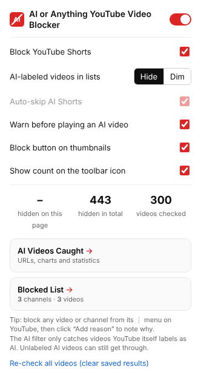
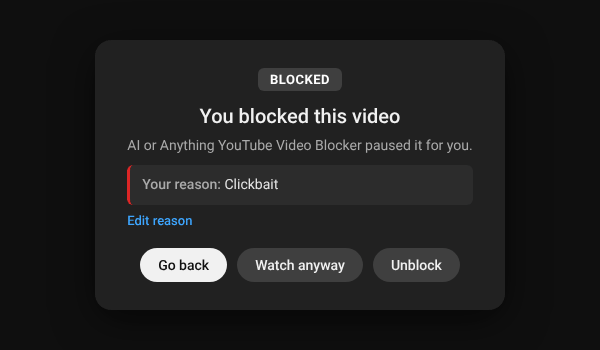
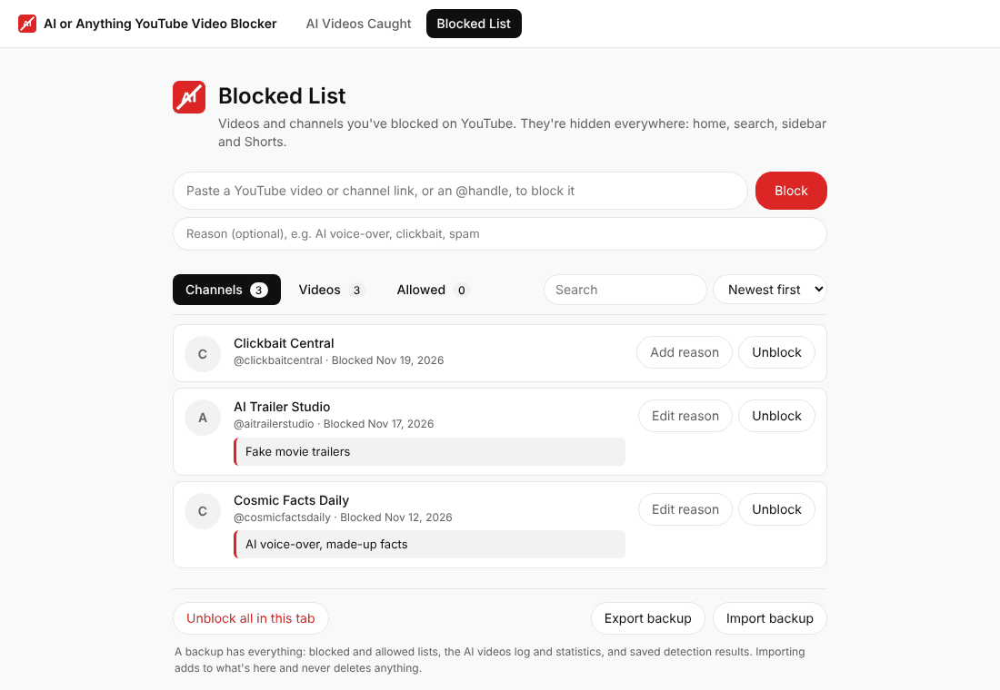
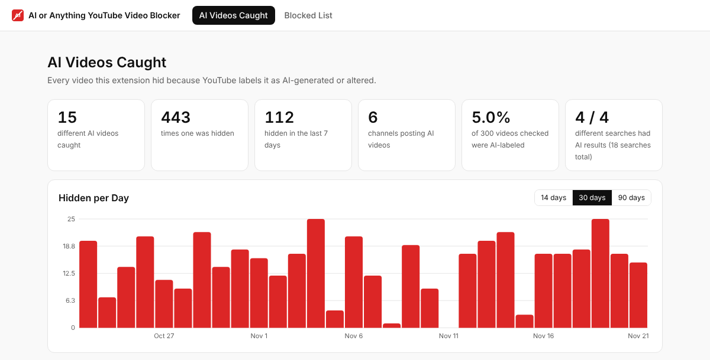

# AI or Anything YouTube Video Blocker

A browser extension for Chrome and Firefox that hides YouTube videos labeled as AI-generated and lets you block any video or channel. You can unblock them at any time.

The irony here is that this extension was created by AI (Claude).

> [!WARNING]
> **For private, personal use. Experimental and not supported. Use at your own risk.**
> It is provided as is, with no warranty, and it may stop working when YouTube changes its website. It is not published in the Chrome Web Store or on Firefox Add-ons.

John L. Whiteman

## What It Does

- Hides videos that YouTube labels as AI-generated. Only labeled videos are caught, so some unlabeled AI videos may still get through.
- Lets you block any video or channel from its ⋮ menu on YouTube and add an optional reason.
- Blocks YouTube Shorts. This is on by default and can be turned off.
- Shows statistics about what was hidden and lets you back up and restore your blocked list.

## Screenshots

The screenshots below use sample data.

**Extension menu**

**Stop screen when you open a blocked video**

**Blocked List**

**AI Videos Caught**

## Privacy

No data is collected or shared. Everything stays in your browser. The extension only contacts YouTube itself to read its AI labels. Uninstalling the extension deletes all of its saved data.

## Install

Download this repository with the green **Code** button and **Download ZIP**, then unzip it.

**Chrome, Edge or Brave**

1. Open `chrome://extensions` and turn on **Developer mode**.
2. Click **Load unpacked** and select the `chrome` folder.

**Firefox**

1. Open `about:debugging#/runtime/this-firefox`.
2. Click **Load Temporary Add-on** and select the `manifest.json` file in the `firefox` folder.

Firefox removes a temporary add-on when it closes. To keep the extension installed, use Firefox Developer Edition, Nightly or ESR and set `xpinstall.signatures.required` to `false` in `about:config`. You can also have it signed privately for free at [addons.mozilla.org](https://addons.mozilla.org/developers/) by choosing **On your own**. A privately signed extension is not listed publicly.

## Uninstall

- In **Chrome**, open `chrome://extensions` and click **Remove** on the extension.
- In **Firefox**, open `about:addons`, click **⋯** next to the extension and choose **Remove**. A temporary add-on is removed automatically when Firefox closes.

## License

Released under the [MIT License](LICENSE). The AI detection approach was adapted from Weedout, which is also MIT licensed.
